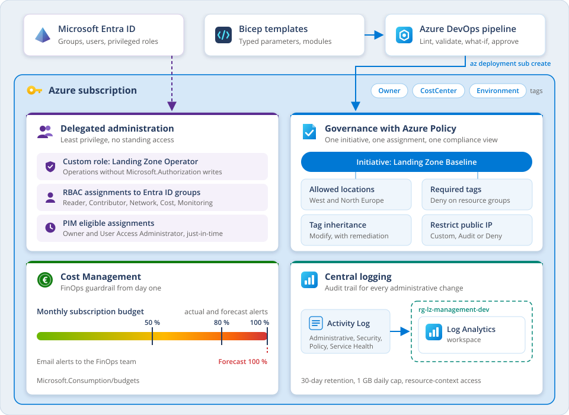

# Azure Landing Zone with Bicep

Subscription-scope landing zone written in Bicep. It applies governance guardrails, delegated administration, FinOps controls and central logging to an Azure subscription, and ships with an Azure DevOps pipeline that validates, previews and deploys every change.


## What it deploys

| Area | Resources | Purpose |
|---|---|---|
| Governance | Custom policy definition, custom initiative, subscription assignment with managed identity | Data residency, mandatory tags, tag inheritance, public IP control |
| Delegation | Custom role `Landing Zone Operator`, role assignments for Entra ID groups | Least privilege for operations teams, no right to change access or topology |
| Just-in-time access | PIM (Privileged Identity Management) eligible assignments, optional | No standing Owner or User Access Administrator rights |
| Cost | Monthly budget with actual and forecast alerts | FinOps (Financial Operations) guardrail from day one |
| Monitoring | Log Analytics workspace, Activity Log diagnostic settings | Central audit trail for administrative, security and policy events |

## Architecture



## Design decisions

- **Subscription scope.** Deployable with Owner rights on one subscription, without tenant root access. The same modules can be promoted to management group scope.
- **Initiative over single assignments.** One assignment, one compliance view, one exemption point.
- **Audit first.** The public IP restriction defaults to `Audit`. Switch to `Deny` once hub components are approved. For brownfield subscriptions, set `policyEnforcementMode` to `DoNotEnforce` to measure impact before enforcing.
- **Tag inheritance with remediation.** The assignment has a system-assigned identity with `Tag Contributor`, so existing resources can be remediated.
- **No standing privilege.** Privileged roles are delivered through PIM eligibility. Operational teams use a custom role that excludes `Microsoft.Authorization` writes.
- **Typed parameters.** User-defined types validate role assignments and tags at build time.
- **Cost-aware defaults.** 30-day retention and a 1 GB daily cap on the workspace.

## Repository structure

```text
.
├── bicepconfig.json                 Linter rules
├── docs/architecture.svg            Architecture diagram
├── infra
│   ├── main.bicep                   Entry point (subscription scope)
│   ├── main.bicepparam              Example parameters
│   ├── types.bicep                  Shared user-defined types
│   └── modules
│       ├── governance/policy-baseline.bicep
│       ├── identity/rbac.bicep
│       ├── identity/pim-eligibility.bicep
│       ├── cost/budget.bicep
│       └── monitoring
│           ├── log-analytics.bicep
│           └── activity-log.bicep
├── pipelines/azure-pipelines.yml    Azure DevOps: validate, what-if, deploy
└── .github/workflows/bicep-validate.yml
```

## Prerequisites

- Azure CLI 2.60 or later with Bicep (`az bicep install`)
- Owner, or Contributor plus User Access Administrator, on the target subscription
- Entra ID P2 for PIM eligible assignments (optional)

## Deploy

```bash
az login
az account set --subscription "<subscription-id>"

# Preview
az deployment sub what-if \
  --location westeurope \
  --template-file infra/main.bicep \
  --parameters infra/main.bicepparam

# Deploy
az deployment sub create \
  --name lz-baseline \
  --location westeurope \
  --template-file infra/main.bicep \
  --parameters infra/main.bicepparam
```

Replace the commented object IDs in `main.bicepparam` with Entra ID groups from your tenant before enabling role assignments.

## CI/CD

| Pipeline | Trigger | Stages |
|---|---|---|
| `pipelines/azure-pipelines.yml` | Pull request and push to `main` | Lint and build, `az deployment sub validate`, what-if, deploy after environment approval |
| `.github/workflows/bicep-validate.yml` | Pull request and push to `main` | Lint and build, no Azure credentials required |

The Azure DevOps pipeline expects a service connection named `Azure-Dev-Test` and an environment named `landing-zone-dev` with an approval check.

## Cost

Policy, RBAC (Role-Based Access Control), PIM and budgets have no direct cost. Log Analytics is billed per GB ingested; with Activity Log only and the daily cap, a lab subscription stays within a few euros per month.

## Clean up

```bash
az policy assignment delete --name lz-baseline
az policy set-definition delete --name lz-landing-zone-baseline
az policy definition delete --name lz-restrict-public-ip
az consumption budget delete --budget-name budget-lz-subscription-dev
az monitor diagnostic-settings subscription delete --name activity-log-to-law --yes
az group delete --name rg-lz-management-dev --yes
```

Custom role and role assignments are removed with `az role assignment delete` and `az role definition delete`.

## Roadmap

- Management group hierarchy (platform, landing zones, sandbox, decommissioned)
- Hub and spoke connectivity: see [azure-bicep-hub-spoke](https://github.com/Solisys-Cloud/azure-bicep-hub-spoke)
- Microsoft Defender for Cloud plans and security contacts
- Backup and Azure Site Recovery baseline

## License

[MIT](LICENSE)
